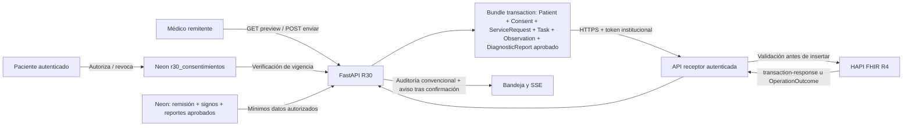

# R30 — Interoperabilidad FHIR R4 (4.0.1) con Consent y Task

## Estado y alcance

Esta entrega **actualiza el piloto R30**, no sustituye R33 ni configura automáticamente el sistema socio. Usa datos **sintéticos** y acceso autorizado. El contrato del intercambio debe pactarse y probarse con el receptor antes de usarlo fuera del laboratorio.

- Backend: FastAPI del proyecto; PostgreSQL/Neon para consentimiento y bitácora; HAPI FHIR para almacenamiento transaccional del receptor.
- Versión del contrato: FHIR **R4 4.0.1**. Confirmar `/metadata` del HAPI instalado antes de declarar compatibilidad real.
- `Bundle.type = transaction`, entradas `PUT` con IDs HMAC estables, y **una única transacción al receptor**.
- Recursos: `Patient`, `Consent` activo, `ServiceRequest` SNOMED CT `306206005`, `Task` inicial `requested`, `Observation` LOINC y únicamente `DiagnosticReport` de IA previamente aprobado.
- `Consent` del bundle **se deriva del registro explícito vigente en `r30_consentimientos`**. No se inventa autorización si falta. `Consent.provision` es `permit` para finalidad de atención. El paciente tiene un ID FHIR seudonimizado.
- `Task.focus` apunta al `ServiceRequest` del mismo bundle y `Task.for` al `Patient`. El estado inicial `requested` no equivale a aceptación del receptor.
- El envío requiere médico remitente autorizado, remisión persistida, paciente sintético y consentimiento vigente. R24 solo genera borrador, no una remisión persistida.
- Autenticación de socio: secreto compartido por dirección (`X-R30-Token`) y HTTPS fuera de laboratorio. Las credenciales se guardan en variables del servidor.
- El receptor responde `422` y `OperationOutcome` si el bundle es inválido **antes de enviarlo a HAPI**, y delega la atomicidad del bundle a HAPI.
- Tras confirmación `transaction-response`, se crea la bitácora de envío, un evento de auditoría **convencional** y una notificación usando `core.eventos.publicar` (bandeja R18 + SSE R17 en una instancia de API).

**No está implementada aquí** la confirmación posterior `Task: accepted/rejected/completed` por el sistema socio, ni el webhook de estados o su firma. Se requiere acordar y desarrollar esa parte en R33. Tampoco se implementa auditoría **encadenada** porque ese mecanismo depende de R28. No considerar la auditoría convencional como prueba de encadenamiento criptográfico. La revocación de consentimiento **detiene futuros envíos desde este emisor**, pero la sincronización de revocaciones con recursos ya almacenados en HAPI/socio debe acordarse en R33.

## Diagrama



## Instalación

1. Crear una copia del proyecto. Copiar los archivos del ZIP sin modificar otros módulos.
2. Si aún **no** aplicaste la migración del piloto, desde `back`: `python scripts/ejecutar_migracion.py 014_remisiones_fhir_r30.sql`. Si ya la aplicaste, **no hace falta una nueva migración** para este ajuste de FHIR.
3. Configurar en `back/pass.env` (no compartir secretos):
   ```ini
   R30_IDENTIFICADOR_SECRETO=SECRETO_LOCAL_LARGO_ALEATORIO_DE_MINIMO_32_CARACTERES
   R30_SOCIO_URL=https://socio.example/fhir/remisiones-r30/recibir
   R30_SOCIO_TOKEN=SECRETO_DE_SALIDA_ACORDADO_CON_EL_SOCIO
   R30_RECEPTOR_TOKEN=SECRETO_DE_ENTRADA_ACORDADO_CON_EL_SOCIO
   ```
   El backend lee esas variables en el contenedor. `R30_SOCIO_URL` no se toma de una entrada de usuario para reducir SSRF. En producción añadir restricción de egreso, rotación de secretos y controles de red.
4. Desde la raíz: `docker compose up -d --build api`.
5. Desde `back`, con `PYTHONPATH` que incluya proyecto y back:
   `python -m pytest tests/test_remisiones_fhir_r30.py tests/test_defensa_prompt_r25.py tests/test_agente_llm_r24.py tests/test_agente_r24.py tests/test_rag.py -q`.

**Autoprueba exclusiva de laboratorio:** se puede usar `R30_SOCIO_URL=http://api:8000/fhir/remisiones-r30/recibir` y hacer que `R30_SOCIO_TOKEN` coincida con `R30_RECEPTOR_TOKEN`; **nunca** compartir la misma clave bidireccional en un despliegue institucional.

## Endpoints

- `POST /fhir/remisiones-r30/consentimiento`: rol **Paciente**, body `{"id_paciente":9900000196,"autoriza":true}`; confirma vinculación del paciente a la cuenta. Revocación con `false`.
- `GET /fhir/remisiones-r30/{id_remision}/bundle`: rol **Medico**, vista previa de Bundle, sin envío. Requiere consentimiento activo.
- `POST /fhir/remisiones-r30/{id_remision}/enviar`: rol **Medico**, envía una **remisión persistida** al socio configurado; HAPI remoto debe confirmar todas las entradas.
- `POST /fhir/remisiones-r30/recibir`: receptor autenticado mediante `X-R30-Token`, recibe **transaction** y lo remite en una única petición a HAPI.

## Contrato propuesto para `Task` (a acordar en R33)

El emisor crea `Task.status = requested`, `Task.intent = order`, `Task.focus = ServiceRequest/{id}`. El receptor debe establecer el ciclo posterior y su significado institucional (p. ej. `accepted`, `rejected`, `in-progress`, `completed`) y enviar confirmaciones autenticadas; esa API de retorno **aún no existe** en este ZIP. El estado del Task en HAPI no reemplaza automáticamente el estado de `public.remisiones`.

## Riesgos residuales

- La atomicidad de HAPI protege **sus escrituras FHIR**, no una transacción distribuida entre HAPI y Neon; un fallo tras la confirmación remota puede dejar la bitácora local sin actualizar. Reconciliación/outbox pendiente.
- El receptor piloto valida un subconjunto significativo de FHIR y depende de HAPI para validación más completa. Verificar su CapabilityStatement, perfiles, versiones y transacciones reales.
- La IP/identidad institucional del socio todavía exige acuerdo R31; el token compartido no equivale a mTLS ni a OAuth institucional.
- El `Consent` ya intercambiado no se revoca automáticamente en el receptor si el paciente cambia la autorización local. Esta sincronización es pendiente de diseño y prueba.
- Las notificaciones por SSE dependen de la configuración real de un proceso/worker de API y del usuario conectado. No se ha probado el SSE del sistema socio.
- `Task` registra el **inicio** del proceso. Aceptación, rechazo, finalización y respuesta/notificación interinstitucional son pendientes R33.
- R28: la auditoría encadenada todavía no se ha implementado en este paquete.

## Pruebas previstas

1. Paciente sintético vinculado otorga consentimiento; la vista previa contiene `Consent` y `Task` válidos.
2. Consentimiento revocado o ausente → no se construye ni envía bundle.
3. Verificar que no aparecen nombres, documentos, direcciones ni reportes IA rechazados en el Bundle.
4. Servicio receptor con token incorrecto → `401 OperationOutcome`.
5. Bundle con `Consent` inactivo o `Task.focus` cruzado → `422 OperationOutcome`, HAPI no recibe la transacción.
6. Bundle válido → `transaction-response`, verificar N respuestas correctas, bitácora/auditoría y aviso R17/R18.
7. Verificar idempotencia del `PUT` tras reintentos.
8. R33: probar receptor del otro equipo, confirmación y actualización posterior de `Task`, notificación y reconciliación.


## R34 · Evidencia de aceptación del piloto actual

Caso sintético **remisión 14 / encuentro 459**: consentimiento activo para `socio-piloto`; Bundle FHIR R4 `transaction` con 11 recursos (Patient 1, Consent 1, ServiceRequest 1, Task 1, Observation 6, DiagnosticReport aprobado 1). Receptor piloto local (`http://api:8000/fhir/remisiones-r30/recibir`, red Docker únicamente) devolvió HTTP 200 y `transaction-response` para las 11 entradas. La aplicación mostró el envío confirmado y bloqueó un reenvío confirmado. Un paquete inválido devolvió HTTP 422 `OperationOutcome`, seguido de 404 para dos IDs de prueba consultados en HAPI.

**Falta probar:** notificación SSE real del envío y consulta SQL de su auditoría en el despliegue definitivo; atomicidad ante un fallo transaccional tardío; credenciales institucionales del socio; recepción/aceptación/rechazo clínico con devolución de Task por el sistema de Annie; validación de unidades UCUM y canal HTTPS externo.

**Precaución:** los tokens de prueba y secreto HMAC residen en `back/pass.env`, que **no** se incluye ni se publica. La URL pública de Quick Tunnel no debe usarse como configuración fija sin comprobar su vigencia.
