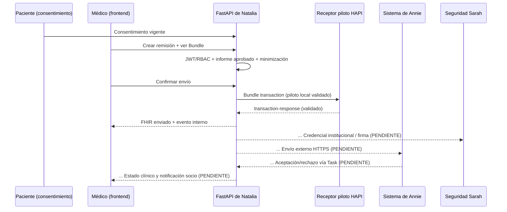

# R34 · Documentación técnica de IA e interoperabilidad de salida (Natalia)

**Proyecto:** Sistema de apoyo al triaje hospitalario — Salud Digital 2026-2  
**Alcance de esta entrega:** R12, R23, R24, R25, R26 y R30 (emisión).  
**Corte de evidencia:** 13–14 de noviembre de 2026, conforme a pruebas realizadas y estructura del repositorio adjunto.  
**Estado:** funcionalidad de Natalia comprobada en entorno local/piloto; R33 interinstitucional externo **pendiente de coordinación**.

> Este es un prototipo académico con datos sintéticos en las pruebas detalladas. Las predicciones no reemplazan la valoración de un profesional ni prueban seguridad/cumplimiento para producción clínica. Las comprobaciones de interfaz y SQL descritas son evidencia de la ejecución reportada, no test automatizados nuevos.

## 1. Aportes y responsabilidades

| Requisito | Aporte | Implementación y evidencia | Estado |
|---|---|---|---|
| R12 | Seudonimización previa a RAG/ML; pruebas canario y filtros | `rag/privacidad.py`, `rag/evaluacion/prueba_canario.py`, `routers/rag.py`; 1758 fragmentos, 585 identificadores de origen, filtros probados con 5 seudónimos, sin fugas detectadas en ese test | Verificado en las pruebas reportadas |
| R23 | Respuestas RAG con citas; abstención y acceso por paciente | `back/routers/rag.py`, `rag/cliente_llm.py`, `docs/RAG.md`, `docs/DATASETS.md ## Corpus`; respuestas F1… y abstención observadas desde front | Verificado funcionalmente |
| R24 | Enrutamiento LLM controlado a tres herramientas | `back/routers/agente_llm.py`, `back/routers/agente.py`, `front/js/asistente.js`; historia, predicción y borrador de remisión probados con Groq | Verificado funcionalmente |
| R24 auditoría | Registro de herramienta, resultado, seudónimo y payload depurado | `auditoria_cambios`, IDs de prueba 300, 301, 302, resultado OK; sin identificadores directos en payload_llm inspeccionado | Revisado para esos registros |
| R25 | Separación instrucciones/datos; detección, registro y bloqueo | `back/core/defensa_prompt.py`, migración `013_defensa_prompt_r25.sql`, UI de rechazo; bloqueo de 15 min activado y expiró | Verificado con casos explícitos |
| R26 | Modelo DFD + STRIDE | `docs/STRIDE.md`, seis categorías, controles, normativa y riesgos residuales | Elaborado; completar evidencias Sarah/Annie |
| R30 | Consentimiento, Bundle y envío interinstitucional piloto | `back/routers/remisiones_fhir_r30.py`, front consentimiento y remisiones, migración `014_remisiones_fhir_r30.sql`; remisión sintética #14, `transaction-response` 11 recursos | Envío piloto confirmado; R33 socio externo pendiente |

## 2. Diseño de R23 · RAG clínico con fuentes

**Finalidad:** responder preguntas del médico/especialista exclusivamente a partir del corpus y de las historias autorizadas, sin inventar datos clínicos cuando faltan fragmentos. R23 **no ejecuta** predicciones ni crea remisiones.

**Ruta:** `POST /rag/preguntar` (públicamente `/api/rag/preguntar`). **Controles:** JWT, roles `Medico`/`Especialista`, filtros de paciente/encuentro, aprobación de historias sintéticas, limpieza de PII y prompt con instrucciones separadas de las fuentes. **Recuperación:** documentos transformados en fragmentos e indexados con embeddings y pgvector; modo denso observado. **Salida:** respuesta con referencias a fragmentos (F1, F3, etc.) o abstención cuando no hay soporte.

**Pruebas observadas:** (a) pregunta sobre signos vitales sin evidencia suficiente → abstención; (b) pregunta sobre guía de atención y triaje → respuesta con fuentes. Las referencias mostradas deben cotejarse con los documentos subyacentes para evaluar su exactitud. La recuperación no equivale a una consulta SQL de signos vitales: para esta última se usa R24.

**Corpus y protección:** `docs/DATASETS.md ## Corpus` documenta guías, textos extraídos, historias sintéticas aprobadas, indexación y limitaciones. La prueba canario tuvo resultado favorable, **sin implicar garantía absoluta** contra toda fuga.

**Riesgo residual:** calidad de extracción/recuperación, alucinaciones y citas no verificadas semánticamente. Se requiere revisión profesional.

## 3. Diseño de R24 · Agente con herramientas autorizadas

**Ruta:** `POST /agente/preguntar`. Groq recibe la pregunta depurada y un catálogo fijo; el backend valida quién puede consultar la historia, ejecuta una sola herramienta y audita. Tres herramientas:

1. `consultar_historia`: lectura de encuentro sintético autorizado y aprobado; devuelve signos LOINC.
2. `ejecutar_modelo`: invoca predictor del backend; las probabilidades **no** se calculan en Groq y `guardado=false` evita reporte automático.
3. `preparar_remision`: construye un borrador `estado=borrador`, `enviado=false`; no crea una remisión clínica persistente.

**Caso sintético:** paciente `9900000196`, encuentro `459`, médico de prueba Rubiela Gómez. `consultar_historia`: triaje IV, dolor 6, FC 82/min, FR 16/min, PAS/PAD 133/80, T 36,6 °C, SpO₂ 99 %. `ejecutar_modelo`: `no_critico` 0,7563; `medio` 0,2083; `critico` 0,0354; `logreg-alarmas-3cat-3.0`. La predicción es académica, no un diagnóstico.

**Auditoría inspeccionada:** `auditoria_cambios` IDs 300 (historia), 301 (modelo) y 302 (borrador), `accion=INVOCAR_HERRAMIENTA` y `resultado=OK`. En los `payload_llm` observados aparecen solamente la instrucción de sistema y una pregunta depurada; las variables clínicas del ML quedaron en otro campo de auditoría y **no** forman parte del payload enviado a Groq en esas pruebas.

**Limitación:** el agente selecciona acciones, no sustituye controles RBAC, la aprobación clínica ni el juicio médico.

## 4. Diseño de R25 · Defensa contra prompt injection

**Amenaza:** texto malicioso en preguntas o en contenido recuperado intenta alterar políticas, exfiltrar pacientes o elevar privilegios. **Defensas:** sistema y datos separados, sanitización, autorización en backend, detección de patrones de instrucciones explícitas, auditoría de intentos y bloqueo temporal por cuenta.

**Persistencia:** migración `013_defensa_prompt_r25.sql`, tablas `r25_intentos_prompt` y `r25_bloqueos_prompt`. Se conserva usuario, ruta, IP observada, categoría y marca temporal. En las pruebas, IP `172.18.0.9` era interna de Docker y **no** identifica por sí misma una IP pública de origen.

**Prueba de integración:** tres intentos explícitos dentro de 15 min provocaron rechazo y bloqueo de 15 min; el bloqueo se mostró en frontend y Neon registró `bloqueo_activo=true`. Al expirar, R23 volvió a responder una consulta permitida. **Regresión reportada:** 51 pruebas aprobadas para conjunto R23–R25; posteriormente 66 aprobadas con R30, antes de las últimas modificaciones del frontend.

**Riesgo residual:** reglas de detección no capturan toda instrucción indirecta u ofuscada; el acceso debe continuar filtrándose en SQL y permisos. El bloqueo no reemplaza controles de red ni validación de identidad institucional.

## 5. Diseño de R26 · STRIDE

La matriz en `docs/STRIDE.md` cubre las seis clases S/T/R/I/D/E, activos, trayectorias, fronteras de confianza y riesgos residuales. El documento distingue controles comprobados de medidas previstas y no constituye certificado de cumplimiento de Ley 1581, Res. 1995, Res. 866 o Res. 3100.

**Falta:** anexar evidencias y resultados de las partes de Sarah (AES-GCM, auditoría encadenada, credenciales institucionales) y Annie (webhooks, verificación de entrada FHIR y respuestas del socio). **PENDIENTE: ...**

## 6. Diseño de R30 · Envío FHIR R4

**Diferencia esencial:** un borrador R24 no transmite ni persiste remisión; en R30 se utiliza una remisión ya registrada por el médico, una cuenta de paciente vinculada y su consentimiento explícito vigente.

**Recursos:** `Bundle.type=transaction` FHIR R4 (4.0.1) con `Patient`, `Consent` (`active`, `permit`, propósito `TREAT`), `ServiceRequest` (SNOMED 306206005), `Task` (`requested`), `Observation` (LOINC) y `DiagnosticReport` solo si el reporte está aprobado/final.

**Datos mínimos:** identificador técnico derivado HMAC, no nombre/documento/dirección en `Patient` piloto; cada recurso clínico referencia al paciente del mismo Bundle. La minimización observada se limita al canal piloto y al caso inspeccionado.

**Rutas:**

| Método y ruta FastAPI | Actor | Acción |
|---|---|---|
| `POST /fhir/remisiones-r30/consentimiento` | Paciente autenticado | Autorizar o revocar |
| `GET /fhir/remisiones-r30/consentimiento/estado` | Paciente autenticado | Consultar vigencia |
| `GET /fhir/remisiones-r30/{id_remision}/bundle` | Médico remitente | Vista previa sin envío |
| `GET /fhir/remisiones-r30/{id_remision}/estado-envio` | Médico remitente | Consultar confirmación / impedir duplicado |
| `POST /fhir/remisiones-r30/{id_remision}/enviar` | Médico remitente | Enviar a receptor configurado |
| `POST /fhir/remisiones-r30/recibir` | Sistema receptor con token | Validar y remitir transacción a HAPI |

**Contrato de seguridad:** `R30_IDENTIFICADOR_SECRETO` (derivación de IDs), `R30_SOCIO_URL`, `R30_SOCIO_TOKEN` y `R30_RECEPTOR_TOKEN` **solo en configuración del backend**. El receptor valida `X-R30-Token`. HTTP interno `http://api:8000/fhir/remisiones-r30/recibir` se usó **solo en prueba Docker**; integración institucional debe usar HTTPS y acuerdo con Sarah/Annie. No documentar valores de secretos.

**Prueba de punta a punta local:** paciente sintético `9900000196` vinculado a cuenta propia, consentimiento para `socio-piloto` con `vigente=true` en Neon; remisión persistida #14, encuentro 459. Vista previa: 11 recursos (1 Patient + 1 Consent + 1 ServiceRequest + 1 Task + 6 Observation + 1 DiagnosticReport aprobado). Rechazo de Bundle inválido: HTTP 422, `OperationOutcome` y dos recursos de prueba no hallados en HAPI (HTTP 404). Envío válido: HTTP 200, `estado=confirmado`, 11 recursos y `transaction-response`; `task_fhir_id` devuelto. Frontend mostró “FHIR enviado” y deshabilitó reenvío confirmado.

**Precisión de evidencia:** dos HTTP 404 después de un rechazo demuestran que esos recursos no existen tras la prueba, pero **no bastan por sí solos para demostrar atomicidad ante fallos internos**; eso requeriría inyectar un fallo transaccional posterior a la validación inicial. Aceptación clínica por el especialista externo y retorno de Task **no se han validado**.

## 7. Diagrama de responsabilidad de salida y retorno (R30/R33)



## 8. Pruebas reproducibles y evidencias que conviene adjuntar

| Prueba | Acción / herramienta | Resultado esperado | Evidencia conocida |
|---|---|---|---|
| R23 RAG | Frontend médico, preguntar sobre corpus y fuentes | Citas F1… o abstención si falta evidencia | Respuesta documental y abstención observadas |
| R24 | Frontend médico, encuentro sintético 459, tres intenciones | Herramienta correcta, resultado controlado | Historia, probabilidades y borrador observados |
| R24 auditoría | SQL `auditoria_cambios` | `INVOCAR_HERRAMIENTA` OK para tres herramientas | IDs 300–302 |
| R25 | Pruebas con prompt malicioso explícito en entorno sintético | Rechazo, registro, bloqueo y desbloqueo | Neon y frontend verificados |
| R26 | Abrir `docs/STRIDE.md` | DFD y seis categorías, evidencia/riesgo/norma | Documento existente |
| R30 consentimiento | Frontend de paciente y Neon | Registro `vigente=true` | Paciente sintético 9900000196 |
| R30 previa | Frontend médico, remisión 14 | 11 recursos y seudonimización | JSON FHIR inspeccionado |
| R30 rechazo | Receptor piloto con Bundle inválido | HTTP 422 `OperationOutcome`, sin recursos de ensayo | HTTP 404/404 posterior |
| R30 envío | Swagger y frontend de médico | HTTP 200 `transaction-response`, botón confirmado | Remisión #14 y 11 recursos |
| R30/R33 externa | Prueba con equipo socio | Intercambio y Task devuelto + notificación | **PENDIENTE: ...** |

**Comando de regresión utilizado anteriormente (ejecutar de nuevo tras integraciones):**

```powershell
cd back
$env:PYTHONPATH = (Resolve-Path ..).Path + ';' + (Get-Location).Path
python -m pytest tests/test_remisiones_fhir_r30.py tests/test_defensa_prompt_r25.py tests/test_agente_llm_r24.py tests/test_agente_r24.py tests/test_rag.py -q
```

Histórico reportado: **66 passed, 1 warning**. Las modificaciones posteriores del frontend y del estado de envío requieren nueva regresión, además de pruebas de integración.

## 9. Diferenciación entre estado técnico y estado clínico

- **FHIR enviado / confirmado:** HAPI receptor piloto confirmó persistencia del Bundle.
- **Remisión pendiente / aceptada / rechazada:** estado del proceso asistencial, controlado por médico/especialista.
- **Task requested:** estado inicial de seguimiento; **no prueba** que el sistema socio haya aceptado la remisión.
- **R33 pendiente:** actualizar Task al recibir aceptación/rechazo por canal autenticado, reconciliar estados y notificar al remitente.

## 10. Límites, salvaguardas y próximos pasos

- Solo datos sintéticos autorizados para las pruebas de interoperabilidad descritas.
- No usar secretos ni datos reales en capturas, archivos de ejemplo o Git.
- No interpretar 66 pruebas exitosas como certificación clínica o seguridad total.
- Corregir/validar unidades UCUM de `Observation.valueQuantity` para interoperabilidad semántica; revisar formato de citas RAG si se mejora UI.
- Verificar registro `r30_envios`, auditoría `REMITIR`, notificación `remision_fhir_confirmada` y recepción SSE en el despliegue de sustentación.
- Coordinar con Sarah/Annie credenciales, webhook y aceptación/rechazo Task; ampliar STRIDE y leyes con evidencias concretas al integrar.

## 11. Apartados a completar por compañeras

**Sarah — seguridad / R27, R28, R31:** `...` (mecanismos finales, rutas, evidencia de pruebas y responsable técnico).

**Annie — receptor / R30–R33:** `...` (URL institucional, endpoint, recepción, firma/token, OperationOutcome, Task de retorno y notificaciones).

**Equipo — Git / sustentación:** `...` (URL repo, PR, URL pública y monitoreo, evidencias cruzadas).
